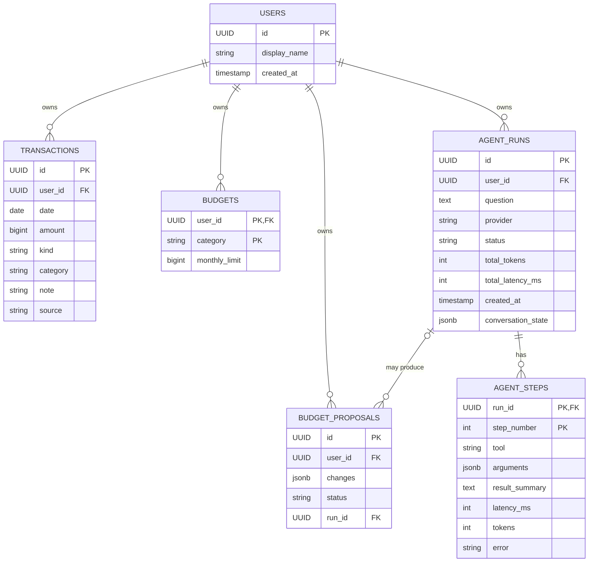

# Spending Coach

> **🚧 Under active development.** Schema, package layout, and this README are still evolving.

A tool-calling AI agent that investigates a user's spending history to answer open-ended money questions — a hand-written agent loop over a Postgres transaction store, not a chat wrapper around an LLM.

## Status

- ✅ **Core agent is built and tested:** 11 read/write tools, a hand-written tool-calling
  loop (no agent framework), guardrails (step cap, wall-clock cap, repeat-call
  detection, JSON-schema argument validation), a full audit trail per run, and a
  human-approval step before any write ever takes effect.
- ✅ **Proven end to end** against a scripted mock model — see [Demo scripts](#demo-scripts)
  — and backed by unit tests plus Postgres/Redis-backed integration tests (`./mvnw verify`).
- 🔜 **Not yet wired in:** real LLM providers (Gemini, Groq) with failover/quota
  handling, a formal evaluation suite, and a Dockerized demo package.

## Spike

Before building any of this for real, a throwaway spike validated the core bet — a
hand-rolled tool-calling loop, not a framework — against two free-tier providers
(Gemini `gemini-flash-lite-latest` and Groq `openai/gpt-oss-20b`) on three gates:
schema validity, tool choice under ambiguity, and knowing when to stop gathering
information versus answer. **Verdict: pass, proceed.** Gemini cleared all three gates
outright (100%, 100%, 90% after a prompt fix); Groq cleared the first two cleanly and
was inconclusive (not failing) on the third — traced directly to its free tier's
token-per-minute budget being exhausted mid-run, not to the model reasoning
incorrectly. Gemini is the reference/target model going forward; Groq is a
free-tier-constrained fallback whose real-world throughput needs explicit
pacing/budget design when real providers are wired in.

## Architecture

This section documents how the system is actually put together as it gets built —
right now that's the database shape (below), a CSV import endpoint, a synthetic data
generator (both detailed after "Running locally"), all 11 of the agent's tools, the
hand-written agent loop that ties them together, and the HTTP API surface in front of
it (below); it will grow to cover real external providers (Gemini/Groq, replacing the
mock provider below) next.

### ERD

The schema below is created by `src/main/resources/db/migration/V1__initial_schema.sql` and mapped by the JPA entities in `persistence/entity`. Every table but `users` is scoped to a user via a `user_id` foreign key; `agent_steps` belongs to one `agent_runs` row, and a `budget_proposals` row optionally records which `agent_runs` produced it.



### Agent tools

The agent reads and acts on a user's transactions through a fixed set of 11 tools —
each one does its own arithmetic/grouping in Java so the model never has to.

| Tool | Arguments | Returns |
| --- | --- | --- |
| `get_overview` | none | date range, transaction count, categories, income entries, monthly totals |
| `spending_by_category` | `from`, `to` | total and share of expenses per category |
| `top_transactions` | `category?`, `from?`, `to?`, `minAmount?`, `limit?` | the largest matching transactions |
| `search_transactions` | `text?`, `category?`, `from?`, `to?`, `limit?` | matching transactions plus the total match count |
| `compare_periods` | `periodAFrom`, `periodATo`, `periodBFrom`, `periodBTo` | per-category change vs. the other period's monthly average |
| `find_recurring_charges` | `minOccurrences?` | charges that repeat by category+note, with a derived cadence and any amount change |
| `detect_anomalies` | `from?`, `to?` | duplicate charges, price changes on recurring charges, and category spending spikes |
| `project_month_end` | none | the current month's cumulative daily balance, and the day it first goes negative (if any) |
| `simulate_savings` | `adjustments` (list of `{category, cutPercent}`) | baseline balance, projected balance, and projected savings after applying the cuts |
| `ask_user` | `question` | never dispatched through the tool registry — the agent loop intercepts it by name, pauses the run, and surfaces the question to the caller |
| `propose_budget_change` | `changes` (list of `{category, newMonthlyLimit}`) | a pending proposal row; nothing changes until a human approves it through the API |

### Agent loop

A hand-written loop (`DefaultAgentLoopService`) ties the tools above together: build
the system+user messages → call the provider → dispatch any requested tool calls →
feed the results back → repeat until the model gives a plain-text answer. Guardrails,
each configurable under `agent.loop.*` in `application.yml`:

- a step cap (default 8) and a wall-clock cap (default 30s), either of which ends the
  run with a partial answer instead of looping forever;
- loop detection — the same tool called with the same arguments a 2nd time gets a
  steering nudge; a 3rd time aborts the run as failed;
- every tool call's arguments are validated against a JSON schema before execution —
  including rejecting malformed or self-referencing input as a clean, structured error
  rather than letting it crash the run;
- `ask_user` pauses the run (persisting the exact conversation to resume from) instead
  of answering immediately, and resumes from that exact point once a human answers;
- every dispatched tool call, including across a pause/resume, is written durably to
  an audit trail (`agent_steps`) with its latency and result summary.

The loop currently runs against a mock provider with no live fixtures wired in by
default — real external providers are next.

### Demo scripts

Three questions exercise the agent end to end against a fixed, deterministic synthetic
dataset (six months of transactions for one user, seed `42`, anchor date `2026-10-31`),
imported through the same CSV pipeline a real upload would use. Each one is proven by
an automated test (`DemoScriptsIT`) that drives the real tool-calling loop, real
Postgres queries, and (for the second question) a real pause-for-approval cycle — only
the model's replies are scripted, standing in for a real LLM until one is wired in.

- **"Why am I running out of money before the 25th this month?"** — the agent pulls
  the account overview, projects the month-end balance, compares this month's spending
  to the prior three-month average by category, and drills into the biggest mover. It
  correctly attributes the shortfall to a cluster of weekend food-delivery charges.
- **"I need to save 15,000 by month end. Rent and school fees can't change."** — the
  agent tries two spending-cut combinations, finds both fall short of the target,
  *asks the user a clarifying question* (pausing the run until answered), then finds a
  combination that clears the target and files it as a pending proposal — nothing is
  ever changed without a human approving it afterward through the API.
- **"Anything weird in my spending?"** — the agent runs anomaly detection, checks the
  flagged transactions, and correctly reports a real duplicate charge and a real
  subscription price increase, while correctly not flagging the normal recurring rent
  and salary transactions as anomalies.

A real model isn't wired in yet (see Status above), so `POST /api/chat` against a
locally running app won't answer these three today — `DemoScriptsIT` is currently the
way to see the full loop run end to end.

## Prerequisites

- Java 21
- Docker (for Postgres/Redis locally, and for the Testcontainers-backed integration tests)

## Running locally

Start Postgres and Redis:

```bash
docker compose up -d
```

Run the app:

```bash
./mvnw spring-boot:run
```

## API

- `POST /api/transactions/import` — upload a CSV file (`multipart/form-data`, field name `file`) in `date,amount,category,note,kind` format. Rows are validated individually, not as an all-or-nothing batch — a bad row is rejected with a specific reason, every other row still imports. The response summarizes what happened:

  ```json
  {"importedCount": 42, "rejectedCount": 0, "rejectionReasons": []}
  ```

  No real auth exists yet — every import currently resolves to a single stand-in user, created automatically the first time anything is imported.

  ```bash
  curl -F "file=@transactions.csv" http://localhost:8080/api/transactions/import
  ```

- `POST /api/chat` — start or resume an agent run. `runId == null` starts a new run
  from `question`; a non-null `runId` resumes a paused run with `answer`. Responds
  with the run's id, status (`COMPLETED`, `AWAITING_USER`, or `FAILED`), the answer
  (once completed), the pending question (while paused), and the step-by-step trace:

  ```bash
  curl -X POST http://localhost:8080/api/chat \
    -H "Content-Type: application/json" \
    -d '{"question": "How much did I spend on dining last month?"}'
  ```

- `GET /api/runs/{id}` — read-only lookup of a run already started via `/api/chat`,
  same response shape. 404 on an unknown id.

- `POST /api/proposals/{id}/approve` / `POST /api/proposals/{id}/reject` — decide a
  pending budget-change proposal created by the `propose_budget_change` tool.
  Approving upserts a `Budget` row per change; rejecting changes nothing. Both are
  one-time decisions — 404 on an unknown proposal id, 409 if it's already been
  approved or rejected.

## Synthetic data generator

For a demo/dev dataset without a real bank export, generate one deterministically from a seed:

```bash
./mvnw spring-boot:run -Dspring-boot.run.arguments="--generate-data --seed=42 --out=synthetic.csv"
```

This writes six months of CSV ending today, covering seven planted spending patterns (a dining spike, a one-off expense, subscription creep, a duplicate charge, a grocery trend, fixed monthly costs, and a day where cumulative balance crosses zero). The same seed always produces byte-identical output. Import it the same way as any other CSV:

```bash
curl -F "file=@synthetic.csv" http://localhost:8080/api/transactions/import
```

## Running tests

Unit tests only (`*Test.java`, no Spring context, no containers):

```bash
./mvnw test
```

Full suite, including Testcontainers-backed integration tests (`*IT.java`) — requires Docker running:

```bash
./mvnw verify
```
