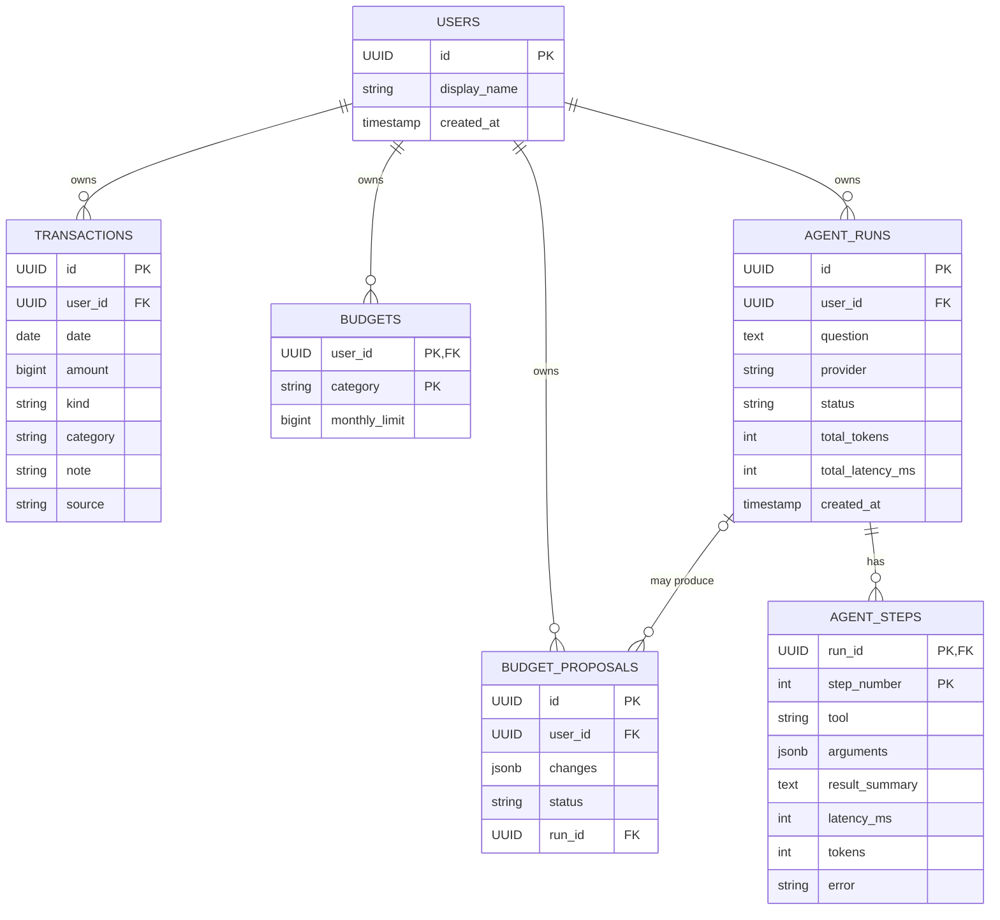

# Spending Coach

> **🚧 Under active development.** Nothing here is stable yet — schema, package layout, and this README are all still moving as each milestone lands.

A tool-calling AI agent that investigates a user's spending history to answer open-ended money questions — a hand-written agent loop over a Postgres transaction store, not a chat wrapper around an LLM.

## Architecture

This section documents how the system is actually put together as it gets built — right now that's just the database shape (below), but it will grow to cover the API surface, the agent loop, and the provider layer as those milestones land.

### ERD

The schema below is created by `src/main/resources/db/migration/V1__initial_schema.sql` and mapped by the JPA entities in `persistence/entity`. Every table but `users` is scoped to a user via a `user_id` foreign key; `agent_steps` belongs to one `agent_runs` row, and a `budget_proposals` row optionally records which `agent_runs` produced it.



## Prerequisites

- Java 21
- Docker (for Postgres/Redis locally, and for the Testcontainers-backed integration tests)

## Running locally

Start Postgres and Redis:

```bash
docker compose up -d
```

Run the app:

```bash
./mvnw spring-boot:run
```

## Running tests

Unit tests only (`*Test.java`, no Spring context, no containers):

```bash
./mvnw test
```

Full suite, including Testcontainers-backed integration tests (`*IT.java`) — requires Docker running:

```bash
./mvnw verify
```
