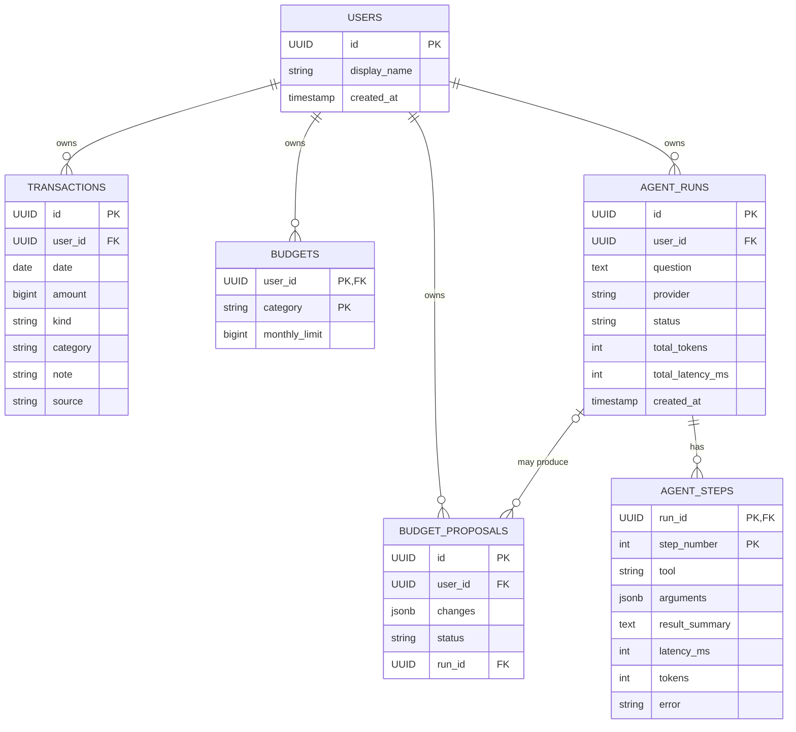

# Spending Coach

> **🚧 Under active development.** Nothing here is stable yet — schema, package layout, and this README are all still moving as each milestone lands.

A tool-calling AI agent that investigates a user's spending history to answer open-ended money questions — a hand-written agent loop over a Postgres transaction store, not a chat wrapper around an LLM.

## Architecture

This section documents how the system is actually put together as it gets built — right now that's the database shape (below) plus a CSV import endpoint and a synthetic data generator (both detailed after "Running locally"); it will grow to cover the agent loop and the provider layer as those milestones land.

### ERD

The schema below is created by `src/main/resources/db/migration/V1__initial_schema.sql` and mapped by the JPA entities in `persistence/entity`. Every table but `users` is scoped to a user via a `user_id` foreign key; `agent_steps` belongs to one `agent_runs` row, and a `budget_proposals` row optionally records which `agent_runs` produced it.



## Prerequisites

- Java 21
- Docker (for Postgres/Redis locally, and for the Testcontainers-backed integration tests)

## Running locally

Start Postgres and Redis:

```bash
docker compose up -d
```

Run the app:

```bash
./mvnw spring-boot:run
```

## API

- `POST /api/transactions/import` — upload a CSV file (`multipart/form-data`, field name `file`) in `date,amount,category,note,kind` format. Rows are validated individually, not as an all-or-nothing batch — a bad row is rejected with a specific reason, every other row still imports. The response summarizes what happened:

  ```json
  {"importedCount": 42, "rejectedCount": 0, "rejectionReasons": []}
  ```

  No real auth exists yet (deferred in the design spec) — every import currently resolves to a single stand-in user, created automatically the first time anything is imported.

  ```bash
  curl -F "file=@transactions.csv" http://localhost:8080/api/transactions/import
  ```

## Synthetic data generator

For a demo/dev dataset without a real bank export, generate one deterministically from a seed:

```bash
./mvnw spring-boot:run -Dspring-boot.run.arguments="--generate-data --seed=42 --out=synthetic.csv"
```

This writes six months of CSV ending today, covering all seven planted spending patterns from the design spec (a dining spike, a one-off expense, subscription creep, a duplicate charge, a grocery trend, fixed monthly costs, and a day where cumulative balance crosses zero). The same seed always produces byte-identical output. Import it the same way as any other CSV:

```bash
curl -F "file=@synthetic.csv" http://localhost:8080/api/transactions/import
```

## Running tests

Unit tests only (`*Test.java`, no Spring context, no containers):

```bash
./mvnw test
```

Full suite, including Testcontainers-backed integration tests (`*IT.java`) — requires Docker running:

```bash
./mvnw verify
```
